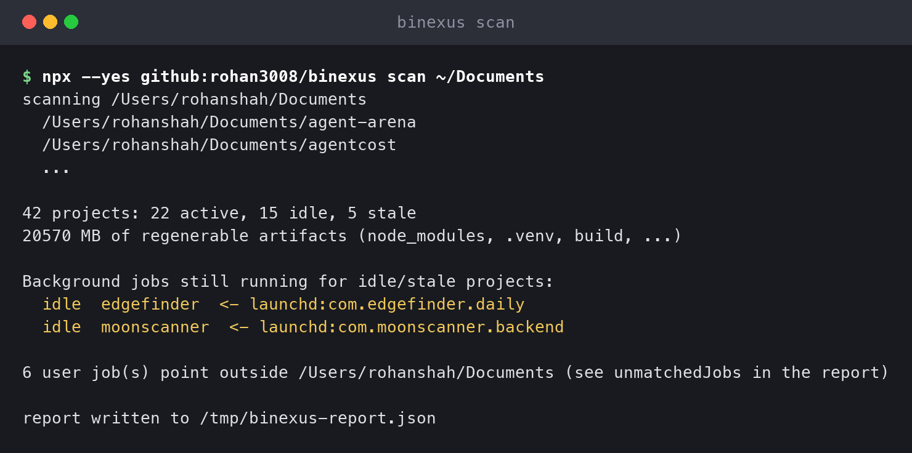
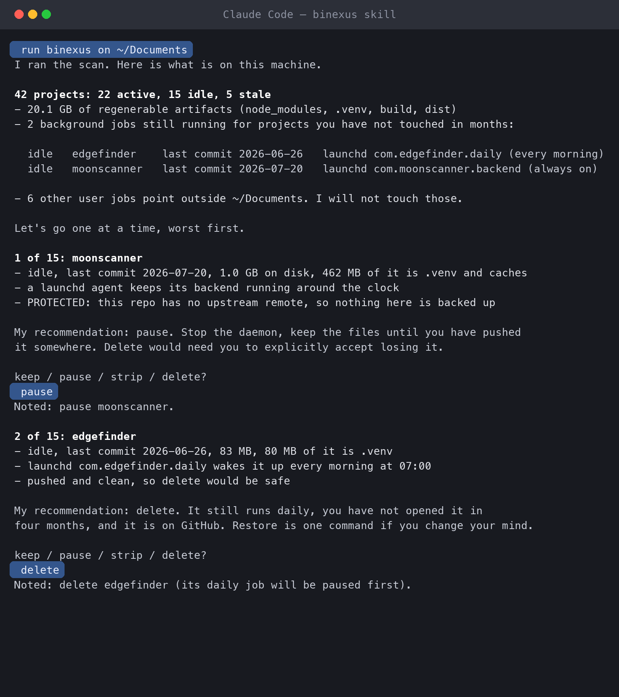
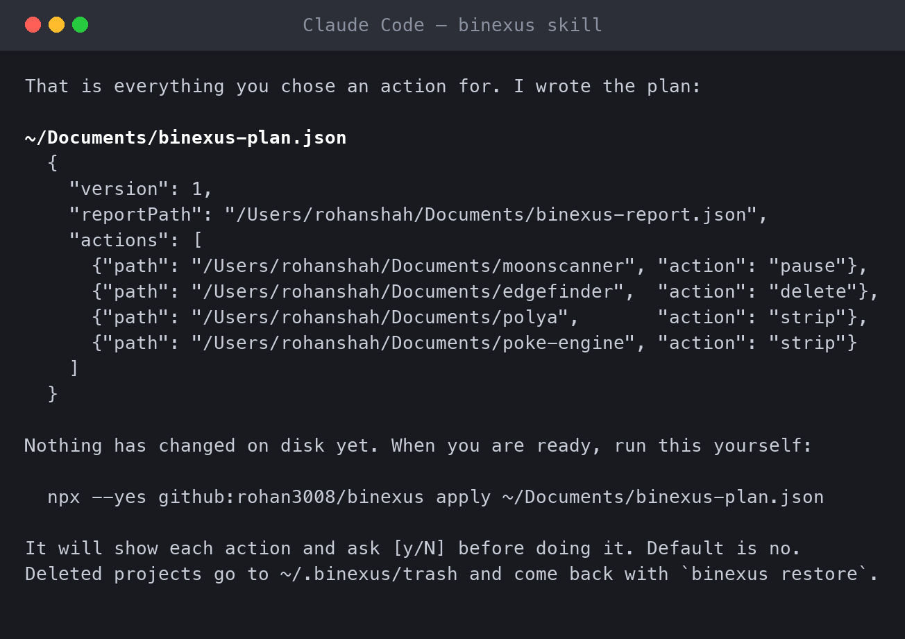
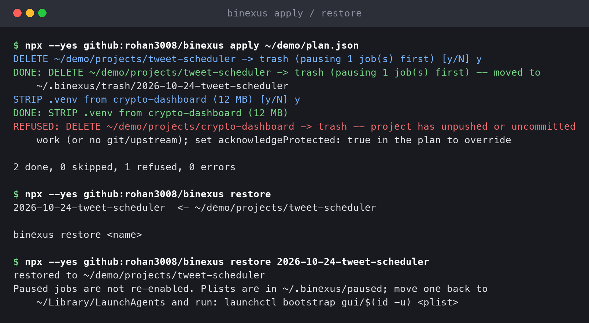

# binexus

[](https://github.com/rohan3008/binexus/actions/workflows/test.yml)
[](https://www.npmjs.com/package/binexus)
[](LICENSE)

Project page: https://rohan3008.github.io/binexus/

**Find the dead vibe-coded projects on your machine and the background jobs
they left running. You decide what to pause, strip, or delete.**

binexus never deletes anything on its own. It scans, your coding agent asks
you project by project, and every action is confirmed again before it runs.
"Delete" means a move to a trash folder you can restore from. Nothing is
ever unlinked.

```
40 projects: 21 active, 14 idle, 5 stale
19164 MB of regenerable artifacts (node_modules, .venv, build, ...)

Background jobs still running for idle/stale projects:
  idle  edgefinder   <- launchd:com.edgefinder.daily
  idle  moonscanner  <- launchd:com.moonscanner.backend
```

That is a real scan of the author's laptop. Two daemons had been waking up
every day for projects untouched since the summer.

## How it looks

**1. Scan.** Read-only. The summary leads with the jobs, because those are
the quiet cost.



**2. Your agent asks you, one project at a time.** Worst offenders first,
with the signals and a recommendation. You answer keep, pause, strip, or
delete. Protected projects say why.



**3. It writes a plan and hands you the command.** Nothing has changed on
disk yet.



**4. Apply confirms every action again.** Default no. A protected project is
refused outright unless you acknowledged it in the plan. Restore brings a
deleted project back. (Demo folder; the launchd job in it is a fixture.)



## Install as a Claude Code plugin (recommended)

```
claude plugin marketplace add rohan3008/binexus
claude plugin install binexus@binexus
```

Or inside a session: `/plugin marketplace add rohan3008/binexus`, then
`/plugin install binexus@binexus`. Then run:

```
/binexus:binexus ~/Documents
```

or just say "run binexus on ~/Documents". The plugin bundles the CLI, so
nothing is downloaded at scan time.

## Install as a plain skill (Cursor, Codex, Gemini CLI, Copilot, ...)

binexus is an [Agent Skill](https://agentskills.io). Your coding agent is
the brain, the `binexus` CLI is the hands.

**1. Add the skill to your agent.** This works for any agent that reads
`SKILL.md` files:

```
npx skills add rohan3008/binexus
```

No `npx skills`? Copy `skills/binexus/SKILL.md` from this repo into
wherever your agent loads skills from (`.agents/skills/binexus/SKILL.md`
is read by most of them; `~/.claude/skills/binexus/SKILL.md` for Claude
Code).

**2. Ask your agent to run it:**

> run binexus on ~/Documents

The agent runs the scan, shows you a summary, then goes through projects
one at a time, worst offenders first. For each one you choose:

| You say | What happens |
|---|---|
| keep | nothing |
| pause | its background jobs stop; files untouched |
| strip | regenerable artifacts are deleted; source and git stay |
| delete | the whole folder moves to `~/.binexus/trash` |

**3. Run the plan it wrote:**

```
npx --yes github:rohan3008/binexus apply ~/Documents/binexus-plan.json
```

You get a `[y/N]` for every action. Default is no.

## Use it without an agent

```
npx --yes github:rohan3008/binexus scan ~/Documents    # read-only, writes report.json
npx --yes github:rohan3008/binexus apply plan.json     # confirms each action, then acts
npx --yes github:rohan3008/binexus restore             # list the trash
npx --yes github:rohan3008/binexus restore 2026-10-22-name
```

The `github:` form runs the latest main straight from this repo. Once the
package is on npm, plain `npx binexus` works too.

`plan.json` looks like this:

```json
{
  "version": 1,
  "reportPath": "/Users/you/Documents/report.json",
  "actions": [
    {"path": "/Users/you/Documents/old-thing", "action": "pause"},
    {"path": "/Users/you/Documents/bigger-thing", "action": "strip"},
    {"path": "/Users/you/Documents/dead-thing", "action": "delete"}
  ]
}
```

Requires Node 20 or newer. No other dependencies.

## What it looks for

A project is any folder with `.git`, `package.json`, `pyproject.toml`,
`Package.swift`, or an `.xcodeproj`. For each one:

| Signal | Meaning |
|---|---|
| last commit, newest source file | last activity. Build artifacts, `.git` internals and gitignored output (logs, databases) do not count, so a daemon writing logs cannot make a dead project look alive. |
| class | `active` under 30 days, `idle` up to 120 days, `stale` beyond |
| protected | unpushed commits, uncommitted changes, no upstream, or not git. Deleting could lose work that exists nowhere else. |
| artifacts | `node_modules`, `.venv`, `venv`, `build`, `dist`, `.build`, `DerivedData`, `.next`, `.turbo`, `.cache`, `__pycache__`, `.pytest_cache`, Rust `target` |
| jobs | launchd agents in `~/Library/LaunchAgents`, crontab lines, pm2 processes whose paths point inside the project |

The jobs are the part nothing else catches. Disk cleaners count bytes. They
do not know a project is dead, and they never look at launchd.

## The three actions and how to undo them

| Action | Does | Undo |
|---|---|---|
| pause | Unloads the launchd agent and moves its plist to `~/.binexus/paused`. Comments out the cron line. `pm2 stop`. | Move the plist back and `launchctl bootstrap gui/$(id -u) <plist>`. Uncomment the line. `pm2 start`. |
| strip | Deletes the artifact dirs listed in the report. Source and `.git` untouched. | Reinstall. |
| delete | Pauses attached jobs, then moves the folder to `~/.binexus/trash/<date>-<name>` with a manifest. | `npx binexus restore <name>` |

## Safety rules

- Nothing is unlinked. You empty `~/.binexus/trash` yourself when you are sure.
- Every action is confirmed at apply time, default no. `--yes-to-strip`
  skips the prompt for strip only.
- A protected project cannot be deleted unless the plan carries
  `acknowledgeProtected: true`, and then you must type the project's name.
- Protection is rechecked at apply time, not just at scan time.
- The agent only reads. The CLI is the only thing that changes anything,
  and it only does what the plan says.
- Set `BINEXUS_HOME` to put the trash on the same volume as your projects
  if a move fails with `EXDEV`.

## Not in v1

Cloud resources (Fly, Vercel, DigitalOcean), Docker containers, Windows.
Open an issue if one of those is the thing costing you money.

## Development

```
git clone https://github.com/rohan3008/binexus
cd binexus
npm test
claude plugin validate --strict .
claude --plugin-dir .          # try the plugin without installing it
```

Tests build their own fixtures in a temp directory and never touch your real
launchd agents or crontab.

## License

MIT
